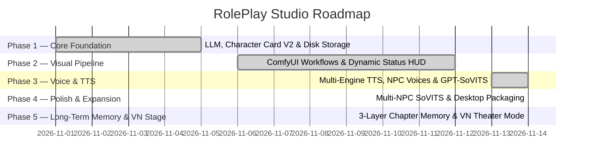

# Milestones & Roadmap

> **Project:** RolePlay Studio (`roleplay-studio`)
> **Last Updated:** 2026-11-14

---

## Visual Timeline

---

## Milestones

### M1 — Core Role-Play Engine & Local Disk Persistence

| Field | Value |
|---|---|
| **Target Date** | 2026-11-05 |
| **Status** | Complete |
| **Phase** | Build |

**Deliverables**
- [x] Multi-provider LLM client (`Ollama` / `OpenAI-compatible`) with bilingual support.
- [x] SillyTavern Character Card V2 import/export & Persona system.
- [x] Local disk database (`data/db.json`) & image storage (`data/images/`) via Vite middleware.

---

### M2 — ComfyUI Visual Pipeline & Dynamic Status HUD

| Field | Value |
|---|---|
| **Target Date** | 2026-11-12 |
| **Status** | Complete |
| **Phase** | Build |

**Deliverables**
- [x] Heuristic ComfyUI workflow mapper (`SDXL`, `Illustrious`, `Qwen-Image-Edit`).
- [x] Dynamic character outfit, location, mood, and inventory HUD (`statusTracker.ts`).
- [x] Generalized in-app Guide & FAQ (`GuideAndFaqView.tsx`) and unified GPU task queue (`aiTaskQueue.ts`).

---

### M3 — Multi-Engine TTS, NPC Attribution & GPT-SoVITS RTX 5070 Ti Setup

| Field | Value |
|---|---|
| **Target Date** | 2026-11-14 |
| **Status** | Complete |
| **Phase** | Build |

**Deliverables**
- [x] 3-Tier 0-VRAM TTS (`Edge Neural` -> `Google Cloud Stream` -> `Windows SAPI`) with automatic 403 fallback.
- [x] Generalized 3-Tier Multi-Voice NPC Attribution for quoted dialogue.
- [x] Self-contained `I:\GPT-SoVITS` installation with PyTorch `2.11.0+cu128` for RTX 5070 Ti, `soundfile` `torchaudio.load` compatibility shim, and Reference-Text-Free custom `.wav` cloning.
- [x] 1-click launchers (`start-roleplay.bat`, `I:\GPT-SoVITS\start-api.bat`, `I:\GPT-SoVITS\start-webui.bat`).

---

### M4 — Advanced Audio Polish & Desktop Packaging

| Field | Value |
|---|---|
| **Target Date** | 2026-11-14 |
| **Status** | Complete |
| **Phase** | Launch |

**Deliverables**
- [x] Per-segment reference `.wav` switching & PCM WAV concatenation in GPT-SoVITS for multi-speaker NPC dialogues (`REQ-008`).
- [x] In-browser **Browse WAV** file upload button (`/api/ref-voice`) in Service Hub and Character Studio (`REQ-005`).
- [x] Rollup `manualChunks` code-splitting optimization in `vite.config.ts` (`vendor-react`, `vendor-icons`, main bundle `< 460 kB`).

---

### M5 — 3-Layer Long-Term Story Memory & Visual Novel Theater Mode

| Field | Value |
|---|---|
| **Target Date** | 2026-11-14 |
| **Status** | Complete |
| **Phase** | Launch |

**Deliverables**
- [x] 3-Layer Long-Term Story Memory (`Rolling Core Synopsis` + `Episodic Chapter Archive` with keyword auto-recall & Pinning + `Auto-Lorebook Extraction`) for 100+ turn campaigns (`REQ-009`).
- [x] Visual Novel (`VN Theater`) Stage Mode with full-stage artwork backdrop, floating Live Status HUD overlay, turn stepper, and translucent VN dialogue box (`REQ-010`).
